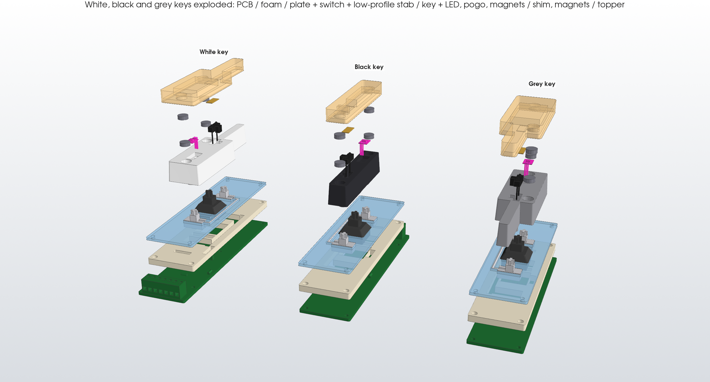
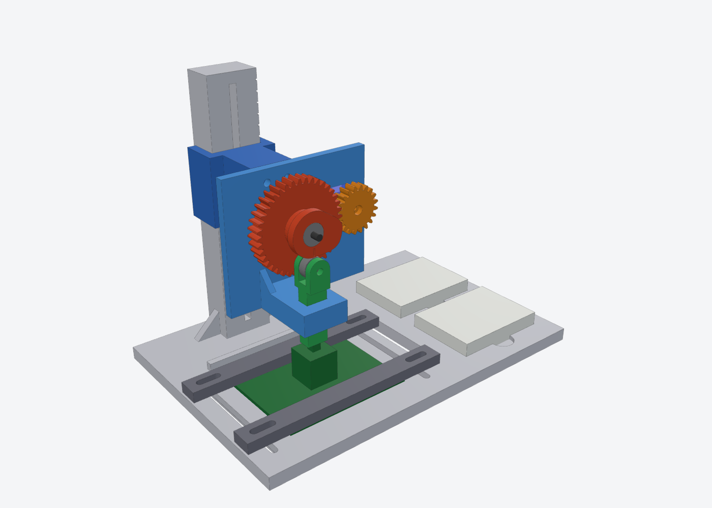

# ModuMIDI 2: Hall-Effect MIDI Keyboard (Capstone)

A modular MIDI keyboard that uses **magnetic (hall-effect) key switches** for analog, velocity-sensitive key sensing. The keyboard is built from identical 30-key **banks** that butt together flush, with the key pitch running straight across each seam. Each bank has its own RP2350 that reads its 30 sensors; a head unit (Adafruit Metro RP2350 with a 2.0" ST7789 display, encoder and buttons) collects the banks and sends USB-MIDI. This project builds on the original ModuMIDI (see `reference/original-modumidi`).

Portfolio page: [aidancarr.tech/modumidi.html](https://aidancarr.tech/modumidi.html)

## Repository layout

```
capstone/
├── README.md
├── design-notes.md            key design decisions and numbers
├── hardware/
│   ├── bank-board/            KiCad bank board (one per bank, 30 sensors, RP2350)
│   ├── bank-plate/            bank switch plate: laser-cut SVG, STEP, FreeCAD
│   ├── key-prototype/         one-key test stacks for the 3u white / black / grey keys: KiCad board, 3D models
│   ├── switch-test-rig/       FreeCAD switch-lifetime test rig (macro, FCStd, STEP, STLs)
│   └── kicad-library/         Capstone_Keyboard KiCad symbols, footprints, 3D models
├── firmware/                  firmware (bank firmware not started)
└── reference/
    └── original-modumidi/     original ModuMIDI: Altium PCB, 3D-printed parts, photos
```

## Status

| Area | Status |
|---|---|
| Parts library (KiCad) | ✅ Done. Needs a 1:1 paper-print fit check |
| Bank plate | ✅ Designed (SVG / STEP / FCStd), not cut yet |
| Bank board: schematic | 🟡 Complete first pass, all wired: RP2350A + flash, 12 V → 5 V → 3.3 V power, 4 analog muxes, 30 key-link connectors (LED chain + key presence), RS-485 bus. Netlist checked; ERC in KiCad 10 still to run |
| Bank board: layout | 🟡 Stepped bank outline, 6 mounting holes, all 214 parts placed (sensors, their capacitors and the key connectors on top; everything else on the bottom). Not routed |
| Head unit | 🟡 Metro RP2350 + display on the bench (see the design notebook); no board yet |
| Key prototype (1 key, 3u, RGB; white / black / grey) | 🟡 Shared board routed (DRC clean), models + cut files for all three keys, not built |
| Switch test rig | ✅ Designed, ready to print (servo dimensions need measuring) |
| Firmware | 🟡 Head-unit bring-up and 31-EDO MPE output tested (design notebook); bank firmware not started, nothing in `firmware/` yet |
| Enclosure / keycaps | ⬜ Not started |

## What's in each part

### Bank layout
Each bank has 30 keys in three rows (white at the front, black in the middle, grey at the back), 10 columns at a **22.86 mm (0.900 in)** pitch, with 3u stabilizers whose wires run front to back (14 × 7 mm housings). The rows are 48.90 mm apart so the white-rear / black-front and black-rear / grey-front housings sit side by side without touching. Banks repeat every **228.60 mm (9.000 in)**. A straight seam would cut through a cut-out, so the side edges have one step: a tab on the left drops into a notch on the right of the next bank. Details are in [design-notes.md](design-notes.md).

### Bank plate: `hardware/bank-plate`
1.5 mm switch plate for one bank (240.03 × 180.34 mm) with the stepped tab and notch, 30 switch cut-outs, 60 stabilizer cut-outs and 8 M3 holes. See its [README](hardware/bank-plate/README.md).

### Bank board: `hardware/bank-board`
One board per bank, shaped like the bank outline and trimmed front and back to the sensors and mounting holes (239.53 × 104.18 mm). 30 pick-and-place **DRV5055A4** hall sensors (SOT-23) sit under the switch centres and go through four analog muxes into the bank's own **RP2350A**. The board makes its own 5 V and 3.3 V from the 12 V on the inter-bank connector and talks to the head unit over RS-485. See its [README](hardware/bank-board/README.md) for every part and why it's there.

### Parts library: `hardware/kicad-library`
Custom KiCad symbols and footprints: RP2350A (QFN-60, from Raspberry Pi's reference design), hall sensors (SOT-23 and TO-92), magnetic MX switch, Cherry stabilizer holes, barrel jack, EC11 encoder, tactile switch, Metro RP2350 shield headers, ST7789 display header. Both KiCad projects already point to it. See its [README](hardware/kicad-library/README.md).

### Key prototype: `hardware/key-prototype`
Single-key test stacks for the three 3u bank keys (white, black, grey): one hand-solderable board shared by all three, foam, an acrylic plate with the bank plate's switch cut-out and Gateron low-profile stabilizer cut-outs (6.25u stabilizers, wire bent to 3u), a key with an LED pixel, and a magnetic diffuser topper with a top-detect pogo contact. See its [README](hardware/key-prototype/README.md).



### Switch lifetime test rig: `hardware/switch-test-rig`
A 3D-printable rig that presses a switch straight down over and over to measure its lifetime: micro servo, 2:1 gears, cam, roller and guided plunger. See its [README](hardware/switch-test-rig/README.md).



## Next steps

**Electronics**
- [ ] Fit-check the library footprints: print them 1:1 and push the real parts through.
- [ ] Run ERC on the bank schematic in KiCad 10.
- [ ] Choose the key-base wiring (flex or wires) and the blind-mate inter-bank header; both have placeholder footprints.
- [ ] Route the bank board, run DRC and order boards.
- [ ] Head-unit side of the bus: an RS-485 transceiver with fail-safe bias resistors.
- [ ] Check that the inner stabilizer housings clear the board under the plate (cut-outs in the board, or enough plate-to-PCB height).

**Firmware (`firmware/`)**
- [ ] Read the sensors through the muxes and calibrate each key (rest / bottom-out).
- [ ] Turn key travel into MIDI note on/off with velocity (and optionally aftertouch).
- [ ] MIDI output, display UI and encoder menu.

**Mechanical**
- [ ] Cut a bank plate and test the switch fit and the tab/notch tiling.
- [ ] Design the enclosure (it must follow the stepped plate profile) and the keycaps.
- [ ] Build the key prototypes (white, black, grey), measure a real Gateron low-profile stabilizer, and test its 12.5 × 6 mm cut-out and bent wire. Then update the bank plate's stabilizer cut-outs to match.

**Testing**
- [ ] Measure the SG51R servo, update the rig macro, then print and build the test rig.
- [ ] Write test-rig firmware (servo cycling, press counter, sensor logging) and run lifetime tests.

## Tools

- [KiCad](https://www.kicad.org) 10: schematics, boards and the parts library. Open `hardware/bank-board/moduMidi.kicad_pro` or `hardware/key-prototype/pcb/spacebarHall.kicad_pro`; the library tables are already set up.
- [FreeCAD](https://www.freecad.org) 1.1: bank plate and test rig.
- Python (manifold3d, trimesh, pyvista): key prototype models and renders.
