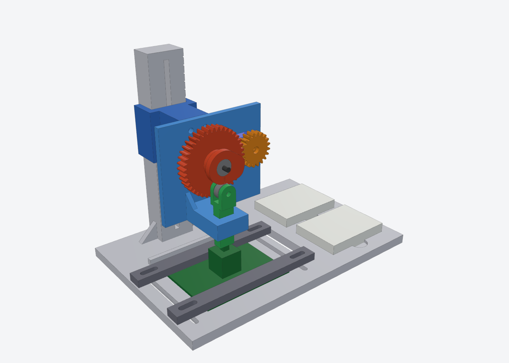

# ModuMIDI 2 — Hall-Effect MIDI Keyboard (Capstone)

A modular MIDI keyboard that uses **magnetic (hall-effect) key switches** for analog, velocity-sensitive key sensing. It is driven by an **Adafruit Metro RP2350** and has an ST7789 display, a rotary encoder and buttons. This project builds on the original ModuMIDI (see `reference material/oldProject`).

> **Last updated:** 2026-11-03

---

## Repository layout

```
capstone/
├── README.md                     ← you are here
├── PCB/
│   ├── moduMidi/                 LibrePCB project (schematic + board)
│   └── libraries/
│       ├── Capstone_Keyboard.lplib   custom parts library (8 devices)
│       └── moduMIDI2.lplib           project library stub
├── mechanical/
│   └── switch-test-rig/          FreeCAD switch-lifetime test rig (macro, FCStd, STEP, STLs)
├── documentation/
│   └── design-notes.md           key design decisions and numbers
├── src/                          firmware (not started yet)
└── reference material/
    └── oldProject/               original ModuMIDI: Altium PCB, 3D-printed parts, photos
```

## Status

| Area | Status |
|---|---|
| Parts library (LibrePCB) | ✅ Done — 8 devices, needs a 1:1 paper-print fit check |
| Schematic | 🟡 In progress — 33 hall sensors + barrel jack placed |
| PCB layout | ⬜ Not started |
| Switch test rig (CAD) | ✅ Designed — ready to print, servo dims need measuring |
| Firmware | ⬜ Not started |
| Enclosure / keys | ⬜ Not started (old ModuMIDI parts available for reference) |

## What's been done

### 1. Custom LibrePCB parts library — `PCB/libraries/Capstone_Keyboard.lplib`
Built in LibrePCB 2.x format (depends on **LibrePCB Base**). It has symbols, footprints and devices for:

| Device | Footprint |
|---|---|
| Adafruit Metro RP2350 (shield headers) | Arduino Uno R3 headers + 4× M3 holes |
| NULLLAB 2.0" ST7789 display | 1×6 2.54 mm header (G, V, SCL, SDA, DC, CS) |
| EC11 rotary encoder with switch | Alps EC11E vertical |
| Omron B3F-5050 tactile switch | B3F 12×12 + 2× boss holes |
| CUI PJ-102AH barrel jack (for MEAN WELL GST60A12) | PJ-102AH THT |
| Hall sensor SS49E / 49E (TO-92) | Lying flat under the key switch, upright wide, upright 1.27 mm |
| Hall sensor TI DRV5055 (SOT-23) | SOT-23-3 |
| MX-style magnetic key switch | "Center Post" / "No Center Post" variants |

See the library's own [README](PCB/libraries/Capstone_Keyboard.lplib/README.md) for pinouts and install steps.

### 2. Schematic started — `PCB/moduMidi`
The LibrePCB project `moduMidi.lpp` has the main schematic with 33 linear hall-effect sensors (U1–U33) and the DC barrel jack (J1) placed.

### 3. Switch lifetime test rig — `mechanical/switch-test-rig`
A 3D-printable rig for cycling a hall-effect switch prototype to measure its lifetime:
- SG51R micro servo → 2:1 gear train → cosine cam → roller → guided plunger, so the switch is pressed straight down with no side load.
- Adjustable height column with a scale, breadboard pockets for the electronics, and a clamp bed for the device under test.
- Parametric FreeCAD macro, assembled `.FCStd`, `.step` and print-ready STLs. The full print list, hardware and assembly steps are in its [README](mechanical/switch-test-rig/README.md).



### 4. Design decisions
Sensor choice, ADC/mux plan, power and display wiring are written up in [documentation/design-notes.md](documentation/design-notes.md).

## Future work

**Electronics**
- [ ] Check the library footprints: print 1:1 and push the real parts through. Also check Metro D22/D23 against its silkscreen and the display cable colours.
- [ ] Finish the schematic: add the Metro, CD74HC4067 analog muxes (the Metro has only 6 ADC pins), the display, encoder and buttons. Add a 100 nF capacitor on every sensor, and power the sensors from 3V3.
- [ ] Pick the final hall sensor (SS49E TO-92 for hand assembly vs DRV5055A4 SOT-23).
- [ ] Lay out the PCB, put each sensor under its switch's magnet, run DRC and order boards.

**Firmware (`src/`)**
- [ ] Read the ADC through the muxes and calibrate each key (rest / bottom-out).
- [ ] Turn key travel into MIDI note on/off with velocity (and optionally aftertouch).
- [ ] USB-MIDI device, display UI, encoder menu.

**Testing**
- [ ] Measure the SG51R and update the `SV_*` parameters in the rig macro, then print and build the rig.
- [ ] Write test-rig firmware (servo cycling + press counter + sensor logging) and run lifetime tests on the switch prototype.

**Mechanical**
- [ ] Design the enclosure, key plates and keycaps (old ModuMIDI parts can be a starting point).

## Tools

- [LibrePCB](https://librepcb.org) 2.x — schematic, PCB and parts library
- [FreeCAD](https://www.freecad.org) — test rig (run `SwitchLifeRig.FCMacro` to regenerate)

### Working on the PCB from this repo
1. In LibrePCB, open `PCB/moduMidi/moduMidi.lpp` from this folder.
2. Library Manager → **Add Library → Local Library** → add `PCB/libraries/Capstone_Keyboard.lplib` and `PCB/libraries/moduMIDI2.lplib`. Make sure **LibrePCB Base** is installed.

The copies in this repo are a snapshot of the LibrePCB workspace from 2026-11-03. Work from the repo copies from now on so changes get committed.

---

## Changelog

| Date | Change |
|---|---|
| 2026-11-03 | Organized repo: added LibrePCB project + libraries, switch test rig, design notes and this README |
| 2026-10-22 | Imported the original ModuMIDI project as reference material |
