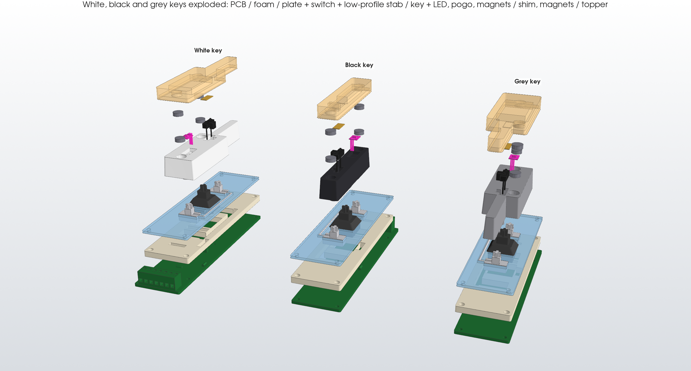
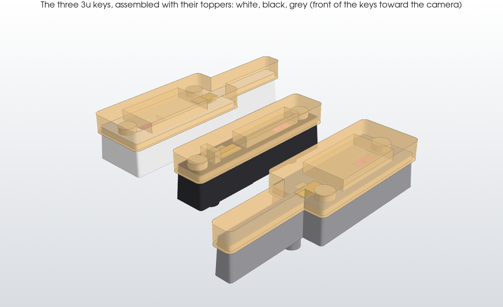
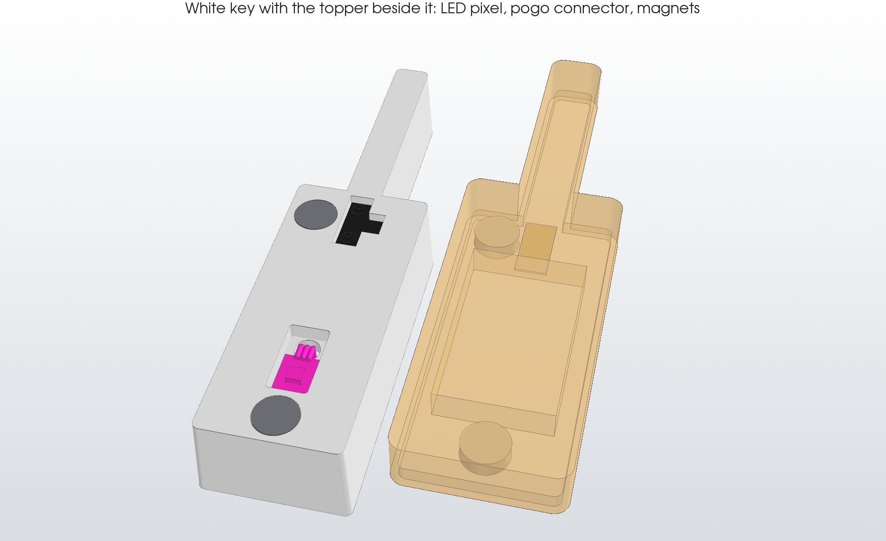
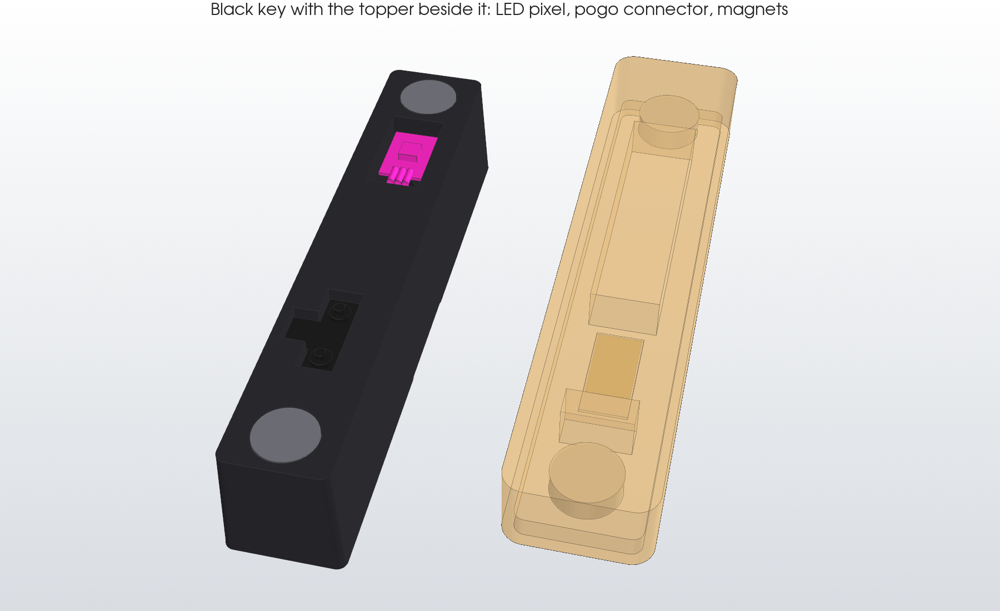
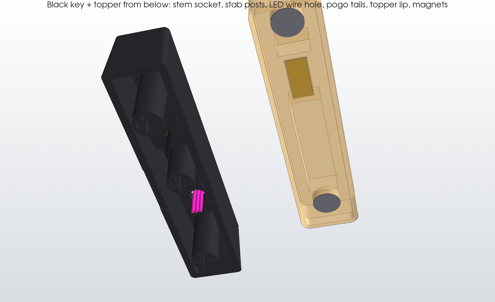
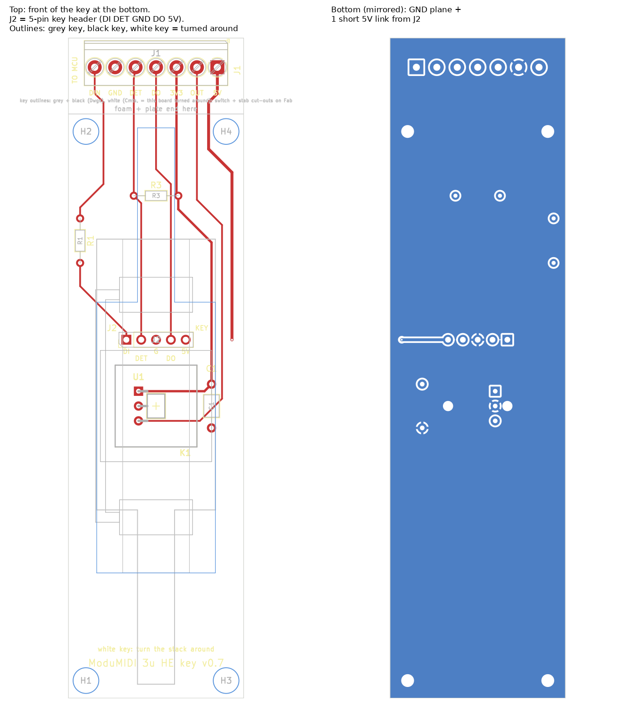
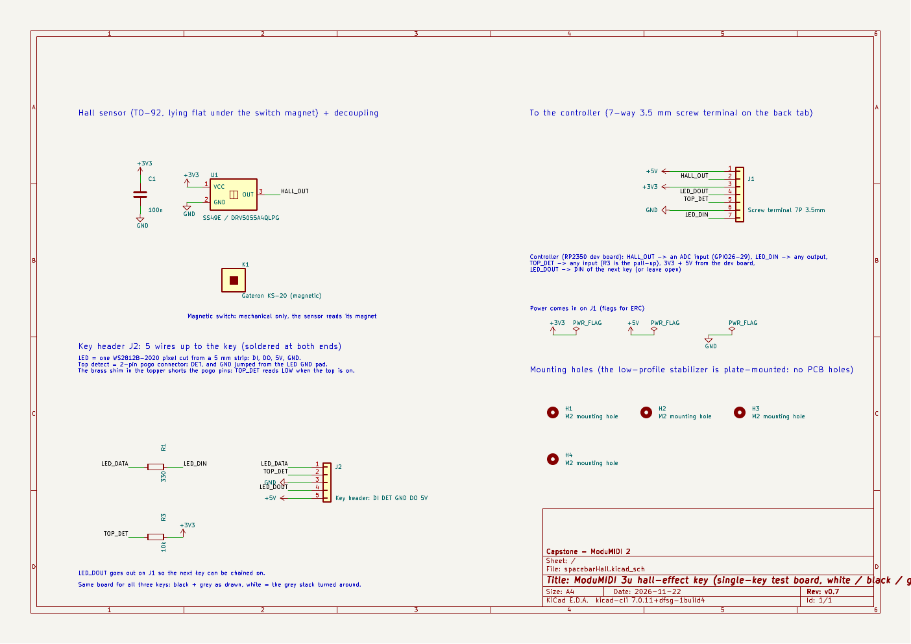

# Key prototype: one hall-effect key, 3u, RGB-lit (white / black / grey)

A single-key test stack for the ModuMIDI 2 bank keys. Each of the three key types has its own set of files: **white** (wide head at the front, narrow tail running back), **black** (narrow, centred on its switch) and **grey** (the white key turned around, head at the back). All three use the same board, switch, stabilizer and layer heights as the bank, and the plate cut-outs match [`bank-plate/ModuMIDI2_bank_plate.svg`](../bank-plate/README.md).

- A magnetic MX-style switch sits under the key, with a **Gateron low-profile plate-mounted stabilizer** (bought as 6.25u, wire cut and bent to 3u) whose housings are 19.05 mm in front of and behind the switch. The key runs front to back.
- One RGB pixel cut from a 5 mm WS2812B-2020 strip sits in a pocket in the key and shines up into a thin, hollow, diffusing topper.
- The topper locates with a lip all round that hugs the top of the key, and is held on by two magnets.
- A 2-pin pogo connector in the key is shorted by a brass shim in the topper, so the controller can tell whether the topper is on.
- Everything on the board is **hand-solderable** through-hole.





Each stack on its own: [white](img/exploded_white.png), [black](img/exploded_black.png), [grey](img/exploded_grey.png).

## Key sizes

Cap outlines from the bank drawing, measured from the key's switch centre (y = toward the back):

| Key | Outline | Switch |
|---|---|---|
| White | Head 20.32 mm wide from y −28.58 to +17.78, tail 6.35 mm wide from +17.78 to +47.63 (76.2 mm long) | 28.58 mm from the front end |
| Black | 11.43 × 57.15 mm, y −28.58 to +28.58 | centred |
| Grey | The white key turned 180°: head from −17.78 to +28.58, tail from −47.63 to −17.78 | 28.58 mm from the back end |

All keys are 12 mm tall with steep walls (the top is 0.6 mm in from the bottom edge all round).

## Layer stack (bottom → top)

| # | Layer | Size | Notes |
|---|---|---|---|
| 1 | **PCB** | 1.6 mm | 30 × 113 mm, shared by all three keys. **U1** TO-92 hall sensor lies flat under the switch centre. **C1** 100 nF axial. **R1** 330 Ω (LED data), **R3** 10 kΩ pull-up (top detect). **J2** 5-pin key header 11.35 mm behind the switch (DI, DET, GND, DO, 5V: the five wires up to the key). **J1** 7-way 3.5 mm screw terminal on a 13 mm tab that sticks out past the foam and plate. |
| 2 | **Foam** | 3.5 mm | Fills the gap between PCB and plate. Cut-outs for the switch, stabilizer housings, wire and wire arms, C1/R1/R3, and the J2 header. |
| 3 | **Acrylic plate** | 1.5 mm | 14.00 mm switch cut-out and two **12.5 × 6.0 mm** low-profile stabilizer cut-outs (Gateron's drawing) 19.05 mm in front of and behind it. **A 1.7 mm slot for the stabilizer wire** runs from each housing's notch out to the bar and along the bar, 9.5 mm to the side of the switch (a U joining the two housings): the wire drops into the slot, the bar pivots there and the arms go through the notches into the sliders. Plus a 12.7 × 2.6 mm slot over J2 for the key's five wires. Each opening is one closed outline in the DXF. |
| 4 | **Key** | 12 mm tall | Centre MX stem socket, and 2 **stabilizer posts** on the centre line that reach down to the low-profile stabilizer (it sits much lower than the full-height switch; the posts stick out below the narrow white/grey tail). On top: **LED pocket** (strip piece + wire bay over the wire hole), **pogo connector pocket** (pins up), **2 magnet pockets**. Underneath: a relief for the switch top housing (the black key is narrower than the switch). |
| 4a | **RGB LED** | 5 × 6.9 mm | **One pixel cut from a 5 mm wide, 144 LED/m WS2812B-2020 strip.** Solder DI, 5V and GND to its DIN-end pads and DO to its DOUT-end pad (lay the DO wire back along the edge of the strip, beside the LED body, to the wire bay). All wires drop through the key's wire hole and the plate slot to J2. |
| 4c | **Pogo connector** | 9.6 × 3.2 mm body (estimated), 5.80 mm pitch | [Top-Link 10101022778](https://www.hktop-link.com/shop/pogo-pin-connectors/2pin-pogo-pin-connector.html), its pin row along the key. The plungers stick up 1 mm above the key top. With the topper on they press flush onto the shim, which shorts them: **TOP_DET goes low = top is on**. Its two wires run inside the key to the LED end: DET down to J2, GND jumped to the LED's GND pad. |
| 5 | **Topper** | **5 mm tall, hollow** | 2 mm walls, 1.0 mm diffuser top, open over the LED. Solid blocks hold **two 6 × 2 mm magnets** and the **4 × 9 mm brass shim** (or copper tape) that shorts the pogo pins. A **1 mm lip** all round reaches 2 mm down the key's sides and locates the topper; the magnets only line up one way round. The topper covers the white/grey tail as a solid strip. |

| Key | LED (wire hole) | Pogo | Magnets |
|---|---|---|---|
| Black | 11.35 mm behind the switch | 11.35 mm in front | on the centre line, 24 mm in front and behind |
| Grey | 11.35 mm behind the switch (in the head) | 11.35 mm in front (where the head meets the tail) | 24 mm behind, and 5.5 mm to the right of the pogo |
| White | the grey layout turned around: LED in front of the switch, pogo behind it | | |

**One board for all three keys.** Black and grey use it as drawn. The white key is the grey key turned around, so the **whole white stack is the grey stack rotated 180°, board included**, and its terminal tab ends up at the front.

The foam and plate are 30 × 100 mm. All three layers share 4 × M2 holes at (±12, ±47) mm. Heights follow the MX spec: plate top is 5.0 mm above PCB top. Key travel is **3.5 mm**, set by the low-profile stabilizer (estimated; the MX switch has 4 mm). A fully pressed key clears the plate, the switch housing and the stabilizer housings, and the stabilizer sliders stay clear of the PCB (checked in the model for all three keys).





## Parts to buy, per key (besides PCB, acrylic, foam, prints)

| Qty | Part |
|---|---|
| 1 | MX-style magnetic switch (e.g. Gateron KS-20), no centre post |
| 1 | [Gateron low-profile plate-mounted stabilizer, 6.25u](https://www.gateron.com/products/gateron-low-profile-plate-mounted-stabilizer?VariantsId=10478): cut and bend the wire so the housings are 38.1 mm apart |
| 1 | Linear hall sensor TO-92: SS49E / 49E, or DRV5055A4QLPG |
| 1 | 100 nF axial ceramic capacitor (about 2 × 4 mm body, 7.62 mm lead spacing) |
| 1 | 330 Ω 1/8 W axial resistor (0204 size) |
| 1 | 10 kΩ 1/8 W axial resistor (0204 size), TOP_DET pull-up |
| 1 | 7-way PCB screw terminal, 3.5 mm pitch, horizontal wire entry (Phoenix PT 1,5/7-3,5-H or a generic "KF350-7P") |
| 1 | 1 × 5 pin header, 2.54 mm (J2); trim the pins to about 1 mm above the plate |
| 1 pixel | WS2812B-2020 strip, 5 mm wide, 144 LED/m (cut one pixel at the copper cut lines) |
| ~20 cm | 30 AWG silicone wire: 5 from J2 up to the key (DI, DET, GND, DO, 5V; leave a slack loop for the key travel) + 1 short GND jumper from the LED to the pogo connector |
| 4 | 6 × 2 mm neodymium disc magnets |
| 1 | 2-pin pogo pin connector, 5.80 mm pitch (Top-Link 10101022778) |
| 1 | 4 × 9 mm piece of 0.3 mm brass shim, or conductive copper tape |
| 4 | M2 screws + nuts / standoffs |

## Folder contents

```
key-prototype/
├── pcb/                       KiCad project (schematic + routed 2-layer board, schematic PDF), shared by all keys
├── mechanical/
│   ├── spacebar_stack.py       parametric source for every part and all three keys (edit numbers at the top, re-run)
│   ├── render_views.py         renders the PNGs in img/ (pyvista)
│   ├── white/                  one folder per key type, each with:
│   ├── black/                    stack_exploded.stl/.glb   the whole design broken apart (GLB coloured per part)
│   └── grey/                     stack_assembled.stl/.glb  everything in its assembled position
│                                 key_assembled.stl/.glb    the key + topper + LED, pogo, magnets, shim
│                                 key_exploded.stl/.glb     the same key broken apart
│                                 stl/                      one STL per part
│                                 cut-files/                DXF outlines for laser-cutting the plate and the foam
└── img/                        renders, KiCad PCB layout + schematic images
```

## PCB: `pcb/spacebarHall.kicad_pro` (KiCad)

Open it in KiCad 7 or newer. The schematic is also saved as `spacebarHall_schematic.pdf`. Positions are from the switch centre, y toward the back of the key.

| Ref | Part | Footprint / position |
|---|---|---|
| U1 | TO-92 linear hall sensor | `Capstone_Keyboard:Hall_TO-92_LyingFlat`. Bend the leads 90° about 1.5 mm below the body and lay it **branded face up**, body centre under the magnet. Pads 3 mm to the left. |
| K1 | Magnetic switch | `Capstone_Keyboard:MX_Magnetic_NoCenterPost` (peg holes at ±5.08 mm) |
| C1 | 100 nF axial | `C_Axial_L3.8mm_D2.6mm_P7.50mm_Horizontal`, at x = +9.5 (lying flat, in the foam cut-out) |
| R1 | 330 Ω axial | `R_Axial_DIN0204…`, LED data, at x = −13, y = +24.5…+32.1 |
| R3 | 10 kΩ axial, TOP_DET → 3V3 | `R_Axial_DIN0204…`, at y = +36 |
| J2 | Key header, left to right: **1 DI / 2 DET / 3 GND / 4 DO / 5 5V** | `PinHeader_1x05_P2.54mm_Vertical` at y = +11.35, under the LED wire hole and the plate slot. The header body sits in the foam; trim the pins to about 1 mm above the plate (full-length pins would touch the black key when pressed) and solder the key's wires to them |
| J1 | 7-way 3.5 mm screw terminal, right to left: **1 5V / 2 HALL_OUT / 3 3V3 / 4 LED_DOUT / 5 TOP_DET / 6 GND / 7 LED_DIN** (labelled on both sides) | `TerminalBlock_Phoenix_PT-1,5-7-3.5-H_1x07_P3.50mm_Horizontal`, pins at y = +58 on the tab, wires enter from the end |
| H1–H4 | M2 mounting holes | `MountingHole_2.2mm_M2` at (±12, ±47) |

- **Ground:** all GND pads are through-hole and GND runs only on the **bottom copper zone**. The only other bottom copper is one short 5V link from the right edge lane to J2. The zone is saved filled; after any edit press **B** to refill it.
- **Drawings:** the grey and black key outlines are on User.Drawings, the white outline (this board turned around) on User.Comments, and the switch, 12.5 × 6 mm stabilizer and wire-slot cut-outs on F.Fab. The low-profile stabilizer is plate-mounted, so the board has no stabilizer holes.
- **Controller wiring** (e.g. an RP2350 dev board): HALL_OUT to an ADC input, LED_DIN to any output, TOP_DET to any input (it reads **LOW when the top is on**; R3 is the pull-up), plus 3V3 and 5V. LED_DOUT goes to the next key's LED_DIN, or leave it open.
- **LED level:** WS2812B on 5 V wants data ≥ 3.5 V. 3.3 V data usually works; if it flickers add a 74AHCT125 level shifter.
- **Libraries:** `../kicad-library/Capstone_Keyboard` (already set up in this project's library tables) and the standard KiCad libraries.
- **Checked:** DRC reports 0 violations and 0 unconnected pads. The schematic netlist and the board match net for net (7 nets, 14 parts), and every footprint is linked to its symbol.




## Assembly / printing notes

- **Magnets.** Glue one magnet into each key pocket, then put the matching magnet on top of it before gluing it into the topper, so the poles always attract. Mark the faces.
- **Key.** Print upside down (stems up), so the pockets face the bed and need no supports.
- **Topper.** Print upside down with the 1 mm diffuser skin on the bed, in translucent / natural PETG or white PLA.
- **Fit.** 0.15 mm per side on the topper lip, stems, LED pocket and pogo pocket (`FIT`).

## Regenerating

```bash
pip install manifold3d trimesh numpy        # + pyvista vtk for the renders
cd hardware/key-prototype/mechanical
python3 spacebar_stack.py                   # STL / GLB / DXF for white, black and grey
python3 render_views.py .                   # PNGs (headless Linux: xvfb-run python3 render_views.py .)
```

Main parameters, at the top of `spacebar_stack.py`: key outlines `CAPS`, steepness `TAPER`, per-key LED / pogo / magnet positions `FEATURES`, topper `TOPPER_*` and lip `LIP_*`, low-profile stabilizer heights `LP_*`, LED strip `LED_SEG`, pogo `POGO_*`, plate cut-outs `SWITCH_CUT` / `STAB_CUT_*`. The LED wire hole's y position must match J2 on the PCB.

## Check before cutting or printing

- [ ] **Stabilizer.** Gateron's drawing gives only the 12.5 × 6.0 mm cut-out and the 1.7 mm notch width. The wire diameter (1.4 mm), stem height (6.5 mm above the plate), stroke (3.5 mm) and housing shape are estimates (`LP_*`, `WIRE_D`): measure a real stabilizer, update them, and test-cut the plate. The bank plate uses the same cut-outs and wire slot.
- [ ] **Wire.** Cut the 6.25u wire and bend it so the arms are 38.1 mm apart and 9.5 mm long (bar to stem centre). Drop it into the plate slot and check it pivots freely and the key presses level.
- [ ] **Switch top housing.** The black key is narrower than the switch, so its underside has a relief over the switch's top housing, modelled as 15.6 mm square tapering to 11 mm over 3.6 mm. Check this against your switch.
- [ ] **Magnets and the sensor.** The topper magnets sit 12–24 mm from the switch centre and move 4 mm with the key, so they add a small field at the hall sensor. Calibrate with the topper on, and check how much the reading shifts with it off.
- [ ] **Hall sensor.** It assumes the magnet is at the switch centre and the switch has room underneath for a flat TO-92 (about 1.5 mm thick).
- [ ] **LED strip.** Measure your piece (5 × 6.9 mm for 144/m). Silicone-coated strips are thicker: change `LED_POCKET_DEPTH`.
- [ ] **Pogo connector size.** Only the pitch (5.80 mm) and working height (5.20 mm) are published. Measure the body, plungers and stroke, then update `POGO_*`. Keep `POGO_PRESS` (1 mm) below the plunger stroke.
- [ ] **Terminal height.** `TB_H` (8.5 mm) is an estimate.
- [ ] **ERC.** Run ERC once in the KiCad GUI (only DRC and the netlist have been checked).
