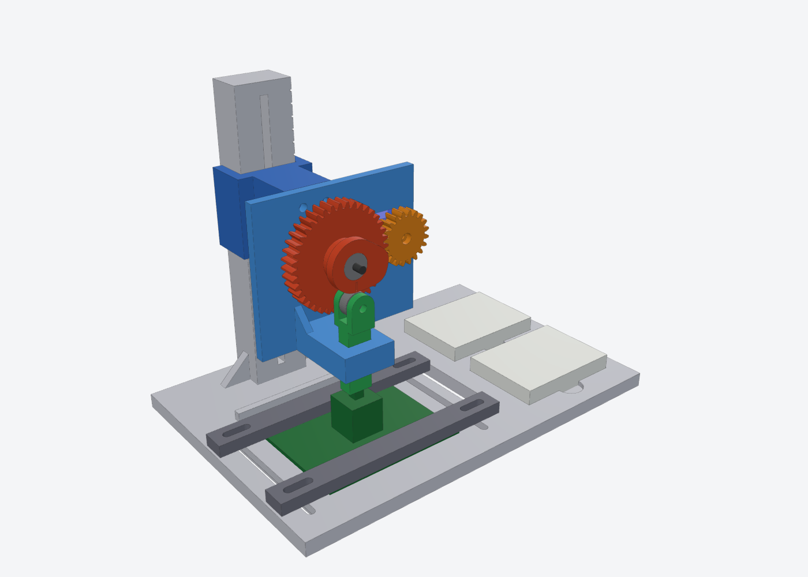

# Switch lifetime test rig

**Drive:** TowerPro SG51R servo → 20T pinion → 40T gear (2:1) → cam → roller → guided plunger → switch.
The plunger runs in a guide, so it only presses the switch straight down with no side load.

## Files
| File | What |
|---|---|
| `SwitchLifeRig.FCMacro` | Parametric source. Edit the PARAMETERS block, then run it with Macro ▸ Macros ▸ Execute |
| `SwitchLifeRig.FCStd` | The assembled model (Printed + Reference groups) |
| `SwitchLifeRig_assembly.step` | Same model for other CAD tools |
| `stl/` | Parts already turned to print orientation |

## Print list (PLA or PETG, 0.2 mm layers, 4 walls)
| Part | Qty | Notes |
|---|---|---|
| Base | 1 | Column is built into the base. Prints as-is, no supports |
| Arm | 1 | Printed upside down (saddle top on the bed) |
| ServoPlate | 1 | Printed back face down |
| CamGear40T | 1 | Gear face down. Use 100% infill or 6 walls |
| Pinion20T | 1 | Use 100% infill |
| Plunger | 1 | Printed lying on its side |
| AxleSpacer | 1 | You can use M3 washers instead |
| ClampBar | 2 | |

## Hardware
- 3× 623ZZ bearings (3×10×4): two in the cam gear, one as the roller
- 1× M3×35 bolt, 1× M3 nut, 1× M3 nylock nut, 2× M3 washers (cam axle)
- 1× M3×16 bolt, 2× M3 washers (roller axle in the plunger fork, with a nylock nut)
- 2× M3×25 bolts, 2× M3 nuts, 2× M3 washers (arm clamp to the column)
- 2× M3×12 bolts, 2× M3 nuts (servo plate to arm)
- 4× M3×20 bolts, 4× M3 nuts (clamp bars; nuts slide in the channels under the base)
- Servo tab screws, the 2 that come with the SG51R
- M2×8 screw in place of the stock horn screw

## Assembly
1. **Servo:** push the case through the window from the front so the tabs sit on the plate, then screw it down.
2. **Horn:** cut the single-arm horn down to about 8 mm from its centre. Press it into the pocket on the back of the pinion (a drop of CA glue helps). Fit it on the spline and fix it with the M2×8 screw.
3. **Cam axle:** put the M3×35 bolt through the back of the plate. Stack on it, in order: nut (snug it against the plate), AxleSpacer, the cam gear with both bearings pressed in, a washer, and the nylock nut.
   Leave the nut loose enough that the gear spins freely.
   The axle hole in the plate is a slot. Slide the gear along it until the teeth mesh with a little backlash, then tighten the first nut.
4. **Plunger:** press the 623ZZ roller into the fork with a 0.5 mm washer on each side. Put the M3×16 bolt through and fit the nylock nut. Then drop the plunger into the guide from above.
5. **Arm:** put the nuts in the hex pockets on the front of the saddle and slide the saddle onto the column. Pass 2× M3×25 bolts with washers through the slot from the back.
6. Bolt the servo plate to the end of the arm (M3×12, nuts in the slots under the beam).
7. Stick the two mini breadboards into their pockets.

## Setting it up
- **Height scale:** the long ticks on the column's right face are 10 mm apart. Read them at the bottom edge of the saddle.
  The plunger tip at rest sits **40 mm below the saddle's bottom edge**.
  The long tick at 40 mm marks a tip height of 0, and each long tick above it adds 10 mm.
- **Rest position:** with the servo at its rest angle, the index notch on the cam points straight down at the roller.
- **Direction:** the cam has to turn **clockwise seen from the front**, so the servo turns counter-clockwise.
  The full 4.5 mm lift comes about **130–170° of servo travel** past rest, with a dwell in that range.
  If you only need a 4 mm stroke, aim for about 110°.
- Set the height so the tip just touches the stem at rest. Then set the servo's press angle so it reaches bottom-out **without stalling** (listen for buzzing).
  The plunger has a hard stop at 6 mm of travel.

## Torque margin
The torque needed is about F·(dlift/dθ). The fastest part of the cam rise is 6.75 mm/rad.
For a 100 gf worst-case switch load, the cam needs about 0.068 kg·cm, and with the 2:1 gearing the servo sees about **0.034 kg·cm**.
The SG51R is rated about 0.6 kg·cm at 4.8 V, which gives roughly a **18× margin**. Without the gears the margin would still be about 9×.

## Things to measure and adjust in the macro
The SG51R dimensions are estimates from published specs. Check these with calipers and edit them at the top of the macro:
`SV_CASE_L`, `SV_CASE_W`, `SV_SHAFT_OFF`, `SV_HOLE_PITCH`, `SV_TAB_Z`, `SV_SHAFT_TOP`.
Breadboard size is `BB_L / BB_W`. The stroke is `CAM_LIFT`.
